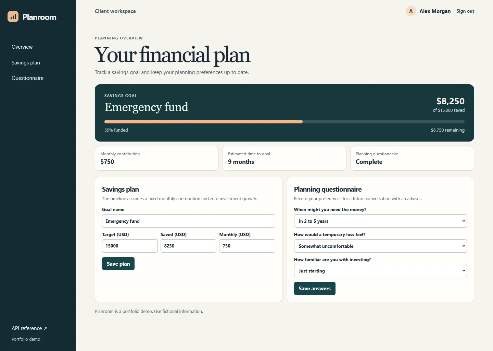

# Planroom

**A client workspace for financial planning, built as a full-stack portfolio demo.** Open an isolated sample workspace, complete a planning questionnaire, and see how recurring savings change the timeline for a goal. The dashboard, sessions, and saved inputs run against a real API and database.

[](https://github.com/mrzroot/planroom/actions/workflows/ci.yml)



[Project overview and projection demo](docs/index.html) · open the HTML file locally to try it without Docker.

## Run it

```bash
git clone https://github.com/mrzroot/planroom.git
cd planroom
cp .env.example .env
docker compose up --build --wait
```

On PowerShell, use `Copy-Item .env.example .env` for the copy step. Open [localhost:8088](http://localhost:8088) and select **Explore with sample data**. Change the monthly contribution from $750 to $1,500 and save. The time estimate drops from nine months to five. Save a questionnaire answer and reload to see it persisted. Use the sign-in form to try registration and re-entry with a sample account.

[OpenAPI](http://localhost:8088/api/docs) · [Compose checks](tests/smoke.py) · [Linux staging and recovery](docs/operations.md)

## Where to look in the code

- **Frontend** — [React workspace](web/src/main.jsx) with account forms, a savings projection, and a questionnaire that saves through the API. The estimate uses whole USD amounts and zero investment growth.
- **Backend** — [FastAPI endpoints](api/main.py), [SQLAlchemy models](api/store.py), and an [Alembic migration](api/migrations/versions/001_workspace.py) on PostgreSQL. The API validates writes and finds each workspace through the current session. Passwords use Argon2 and the database stores only hashes of the random session tokens.
- **Operations** — [Docker Compose](compose.yaml) gates startup on database and API readiness. [Nginx](web/nginx.conf) serves the React build and proxies the API on the same origin. [GitHub Actions](.github/workflows/ci.yml) builds the stack and checks it over HTTP from the public entry point.

Run the smoke checks against a running local stack with `python tests/smoke.py`. Stop it with `docker compose down` to keep the database volume for the next start.

**Scope.** This sample uses fictional data and a single-client workspace per account. The staging runbook describes a reviewer-only deployment.

<div dir="rtl">
<h2>معرفی فارسی</h2>
<p>پلن‌روم یک نمونه‌کار فول‌استک برای پنل مشتریِ یک سامانهٔ برنامه‌ریزی مالی است. پس از ورود با داده‌های نمونه، می‌توانید پرسش‌نامه را تکمیل کنید، مبلغ پس‌انداز ماهانه را تغییر دهید و زمان رسیدن به هدف را ببینید.</p>
<p>رابط کاربری با React ساخته شده است. API با FastAPI، داده‌ها با PostgreSQL و SQLAlchemy، و اجرای سرویس‌ها با Docker Compose پیاده‌سازی شده‌اند. راهنمای عملیاتی مخزن مراحل راه‌اندازی محیط آزمایشی، پشتیبان‌گیری و بازیابی پایگاه داده را توضیح می‌دهد.</p>
</div>
